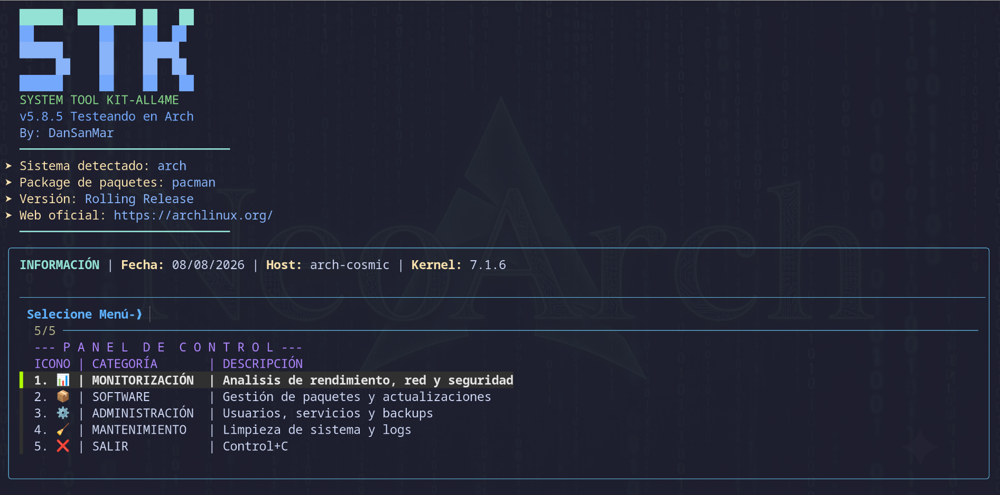

<div align="center">

<!-- BANNER PRINCIPAL -->


<!-- ETIQUETAS ESENCIALES -->


# 🛠️ STK - System Tool Kit (v6.6.6)

</div>

**System Tool Kit (STK)** es una solución integral de administración y mantenimiento para sistemas Linux (probada en Debian, Ubuntu, Kali, Arch Linux, Fedora, openSUSE y entornos WSL2). Diseñada para ofrecer la máxima flexibilidad, permite la gestión rápida del sistema mediante **banderas por línea de comandos (CLI flags),** mediante una interfaz gráfica de terminal interactiva potenciada por **FZF** o con tareas programadas con Cron.

## 🚀 Características Principales

* **Abstracción de Paquetes:** Motor de detección inteligente que unifica la sintaxis de `apt`, `dnf`, `pacman` y `zypper`, con soporte para `rpm-ostree` en sistemas inmutables.
* **Interfaz Dinámica:** Menús interactivos potenciados por `fzf` con previsualizaciones en tiempo real.
* **Monitor de Rendimiento:** Tablero visual en tiempo real con barras de estado para **CPU**, **RAM** y **Disco**.
* **Gestión de Backups Pro:** Sistema de copias de seguridad con verificación de espacio, integridad **SHA256** y rotación automática.
* **Seguridad y Auditoría:** Registro de actividad (Logs) persistente y comprobación estricta de privilegios.
* **Funciones de la v.5.8.1:** Se añade una opción para restaurar los Backups y una pequeña Auditoria de Seguridad. 
* **Funciones de la v.5.9.1:** Se añade un Modo Auto al menú principal, una forma directa de actualizar, limpiar, auditar la seguridad y revisar los servicios fallidos. 
* **Nuevas funciones de la v.5.9.4:** Se añade una opción de gestión de Firewall con UFW dentro del menú de Auditoria de Seguridad.
* **Nuevas funciones de la v.5.9.5:** Se añade menú de gestión de tareas programadas con Cron.
* **Nuevas funciones de la v.5.9.7:** Se añaden flags para la utilización directa de las funciones más habituales y una ayuda para recordarlas.
* **Nuevas funciones de la v.6.5.0:** Logo renovado al estilo PROC4ME y dashboard de estado en los menús con servicios fallidos, puertos abiertos, temperatura, UFW, SSH e Internet.
* **Nuevas funciones de la v.6.6.0:** Cabecera animada (colores cada 3 s y reloj en vivo) y Modo Auto reforzado con checklist de pasos, preflight, snapshot previo, timeouts, auditoría ampliada e informe en pantalla y bitácora.
* **Mejoras de la v.6.6.1:** Menús sin esperas al salir, dashboard con carga/RAM/disco/temperatura y bloque de seguridad refrescado en segundo plano.
* **Mejoras de la v.6.6.2:** Comprobación de Internet unificada y fiable (estilo dash4me), informe JSON del Modo Auto generado con `jq`, limpieza de huérfanos de `pacman` corregida, nueva sección **Seguridad** en el menú principal y **JOBS4ME**, dashboard de análisis de servicios y tareas programadas con explorador FZF.
* **Mejoras de la v.6.6.4:** Integración de **INSTALL4ME** como instalador por categorías en el menú de Software, con paleta FZF y log unificados con STK, y biblioteca `stk_header.sh` de cabeceras responsive.
* **Mejoras de la v.6.6.5:** Modo Auto con limpieza segura (sin desinstalación de paquetes ni papeleras), informe sin JSON —resumen en pantalla y bitácora con avisos e incidencias—, lógica compartida con el programador Cron mediante `stk_auto_lib.sh` y lock exclusivo común, y notificaciones de escritorio revisadas.
* **Mejoras de la v.6.6.6:** `hard4me.sh`, dashboard de monitorización del disco con salud SMART/NVMe, veredictos interpretados, capacidad e inodos, rendimiento, capas (LVM/RAID/Btrfs/ZFS/LUKS/swap) y temperatura. Solo lectura, sin exigir root, con instalación de dependencias bajo pregunta.
---

## 🏗️ Arquitectura y Robustez Técnica

### 1. Motor de Detección de Distribuciones
El script lee las variables de `/etc/os-release` con lógica de caída escalonada (*fallback*) para garantizar compatibilidad completa en distros basadas en Debian, Arch, RedHat y SUSE.
* **Sistemas Compatibles:** Debian, Ubuntu, Linux Mint, Kali Linux, Fedora, RHEL, CentOS, Rocky Linux, Arch Linux, Manjaro, openSUSE, entornos integrados bajo **WSL2** y sistemas inmutables basados en OSTree (Fedora Silverblue, Kinoite y COSMIC Atomic).

### 2. Gestión Inteligente de Dependencias y Entornos
* **Verificación de Herramientas:** Comprueba automáticamente la disponibilidad de las 13 utilidades esenciales del sistema (`fzf`, `xsltproc`, `host`, `tput`, `free`, `curl`, `wget`, `tar`, `hostname`, `jq`, `rsync`, `crontab`).
* **Sintaxis y Compatibilidad JS:** Detecta dinámicamente el motor de JavaScript disponible en la máquina (`js`, `js128`, `js115`, `qjs`, `gjs`, `node`, `nodejs`) y genera un enlace simbólico de compatibilidad en `/usr/local/bin/js` cuando es necesario.
* **Resolución Automática:** Ofrece la instalación guiada de herramientas faltantes adaptándose al gestor de paquetes de la distribución detectada, incluido `rpm-ostree` en sistemas inmutables.

### 3. Optimización de Rendimiento
* **Mínimo Overhead:** Basado en herramientas nativas de administración del sistema (`awk`, `sed`, `grep`, `du`, `jq`).
* **Refresco Visual Eficiente:** Uso de `tput` y secuencias de escape ANSI en el monitor de rendimiento (intervalos de 5 segundos) para actualizar el tablero en pantalla sin parpadeos ni consumo innecesario de procesador.

### 4. Cabeceras Responsive Compartidas
`stk_header.sh` centraliza la estética de los módulos (colores, menús FZF y salida) para que cualquier script nuevo herede el mismo aspecto con unas pocas líneas:
* **API única:** `stk_init MODULO VERSION SUBTITULO [EXTRA]`, `stk_header`, `stk_fzf_menu`, `stk_salir` y `stk_header_cmd` (para cabeceras vivas en FZF).
* **Barra llena adaptativa:** el título se centra con relleno de `━` según el ancho real; no se usa centrado con espacios, que descuadra con emoji.
* **Medición fiable:** `stty size` → `tput cols` → `$COLUMNS` → 80, y `wc -L` para contar columnas visibles (caracteres anchos incluidos).
* **Tres modos:** completo (≥90 columnas y ≥20 filas), normal (≥60) y compacto (pantallas estrechas o bajas), con truncado seguro.
* **Estilo PROC4ME:** módulo, subtítulo, `By: DanSanMar`, versión y hora con colores rotativos por segmentos; el autor siempre en la barra superior.
---

## 🛡️ Medidas de Seguridad y Fiabilidad

* **Control de Privilegios:** Verificación obligatoria de `EUID 0` (`root`) al iniciar el script para evitar fallos de ejecución a mitad de tareas del sistema.
* **Gestión de Señales (Traps):** Captura de interrupciones `SIGINT` (Ctrl+C) y `SIGTERM` para garantizar una salida limpia, restaurando las propiedades del terminal y finalizando los procesos en segundo plano (*spinners*).
* **Logs y Auditoría del Sistema:**
  * **Bitácora Principal:** Almacenada en `/var/log/stk_mantenimiento.log` con permisos restringidos `0640`.
  * **Registro de Tareas Programadas:** Salida del módulo cron en `/var/log/stk_cron.log`.
  * **Rotación Automática:** Truncado e inicio limpio del log central al superar los **500 KB** de tamaño.
* **Fiabilidad en Backups (Local y COPY4ME):**
  * **Verificación Espacial:** Cálculo del tamaño del directorio origen frente al espacio en disco disponible antes de iniciar la copia o sincronización.
  * **Protección de Archivos:** Asignación de permisos `0600` en las copias comprimidas (`.tar.gz`) para restringir lecturas no autorizadas.
  * **Integridad Garantizada:** Generación y verificación de suma de comprobación **SHA256** para los respaldos empaquetados.
  * **Rotación y Perfiles:** Límite máximo de 5 ficheros por subcarpeta de respaldo en `/var/backups/stk_backups/` y almacenamiento seguro de la configuración de perfiles en `config.json`.
---

## 📋 Módulos del Sistema

### 📊 Monitorización y Seguridad
* **Hardware y Carga:** Monitor en tiempo real con refresco de 5s para uso de CPU, memoria RAM y almacenamiento con **barras de estado en color**.
* **Diagnóstico de Red:** Lectura de IP local, interfaces activas e IP pública mediante API externa con consulta DNS de contingencia.
* **Seguridad y Firewall:** Control del cortafuegos (`ufw`), verificación de permisos SUID, cuentas con UID 0, firmas y análisis de accesos no autorizados.
* **Investigador de Procesos (PROC4ME):** Análisis de procesos, puertos, persistencia y amenazas silenciosas, con informes exportables a texto y Markdown desde el menú de **Seguridad**.
* **Analizador de Servicios (JOBS4ME):** Dashboard de servicios, consumo y tareas programadas con veredictos interpretados y explorador FZF.
* **Monitor de Disco (HARD4ME):** Salud SMART/NVMe con veredicto explicado, capacidad e inodos, rendimiento por dispositivo, capas (LVM/RAID/Btrfs/ZFS/LUKS/swap), temperatura y top de espacio bajo demanda. Solo lectura; si faltan `smartctl`/`nvme` pregunta antes de instalar y puede degradar a `N/D` sin root. Se accede desde **Monitorización → 4. Análisis de Disco** o con `-D, --disk`.

<div align="center">

</div>

### 📦 Gestión de Software
* **Sincronización Multidistro:** Actualización centralizada para `apt`, `pacman`, `dnf`, `zypper`, además de gestores secundarios como `flatpak` y `snap`.
* **Instalación Segura:** Instalación y purga completa de aplicaciones con validación estricta de entradas para prevenir inyecciones de comandos.
* **Instalador por Categorías:** `install4me.sh` ofrece aplicaciones organizadas por escritorio, desarrollo, sistemas, seguridad y utilidades, con fuentes híbridas (repositorios nativos, Flatpak, GitHub y AUR) y soporte para sistemas inmutables. Se accede desde **Software → 2. Instalador por categorías**.

### ⚙️ Administración y Servicios
* **Gestión de Usuarios:** Creación, edición y eliminación interactiva mediante `fzf` de usuarios estándar (UID >= 1000) con asignación dinámica de grupos administrativos (`sudo`/`wheel`).
* **Control de Systemd:** Explorador visual de servicios del sistema (activos, fallidos o búsqueda manual) con acciones para iniciar, detener, reiniciar y revisar la bitácora con `journalctl`.

<div align="center">
  
</div>

### 🧹 Mantenimiento, Tareas y Copias de Seguridad
* **Limpieza segura (modo auto):** Solo cachés del gestor, logs del journal con más de 7 días y miniaturas sin uso; no desinstala paquetes ni toca papeleras ni archivos personales. Muestra siempre lo que va a hacer.
* **Limpieza completa (menú / `-c`):** Añade `autoremove` (sin `--purge`), paquetes huérfanos y vaciado de papeleras, este último con confirmación explícita e irreversible.
* **Motor COPY4ME & Backups:** 
  * **Empaquetado Local:** Respaldos compresión `.tar.gz` de directorios clave (`/etc`, `/var/www`, `/home`) o personalizados, con cálculo de hash **SHA256** y rotación de un máximo de 5 ficheros.
  * **Sincronización Avanzada:** Sincronización incremental, espejo o bidireccional mediante `rsync`, con perfiles persistentes en `/var/backups/stk_backups/config.json`.
* **Programador (Cron):** Integración con `stk_cron.sh` para la automatización y consulta de tareas programadas en el sistema. El wrapper y el modo auto comparten `stk_auto_lib.sh` y el mismo lock `flock`. Las notificaciones de escritorio no instalan dependencias por su cuenta, leen el último bloque completo del resumen y se activan/desactivan desde la opción **5. Notificaciones** del menú de tareas automáticas.

### 🤖 Modo Auto Integral
* **Checklist de pasos:** Menú `fzf --multi` para elegir actualización, limpieza, auditoría y servicios, todos marcados por defecto. `TAB` marca/desmarca, `ENTER` confirma y `ESC` cancela. Sin terminal interactiva se ejecutan todos.
* **Preflight:** Comprueba red, espacio libre, gestor de paquetes ocupado y batería antes de empezar. Si algo no es seguro, omite la actualización y continúa con el resto.
* **Snapshot previo:** Punto de recuperación con `snapper`, `timeshift` o respaldo de la lista de paquetes en `/var/lib/stk/snapshots/`.
* **Ejecución robusta:** Lock `flock` compartido con el cron contra ejecuciones simultáneas, timeouts por paso y `Ctrl+C` que libera el bloqueo y vuelve al menú.
* **Informe:** Resumen por módulo, duración por paso, preflight, espacio liberado, incidencias de actualización, alertas y reinicio pendiente. No se genera JSON: todo queda en pantalla y en la bitácora `/var/log/stk_mantenimiento.log` (con rotación que conserva el historial en `.1`).
* **Códigos de salida:** `0` todo correcto, `1` completado con avisos, `2` error grave y `3` ya había una ejecución en curso.


<div align="center">
   
   </div>

---

## 🛠️ Instalación y Uso

1.  **Clona el proyecto:**
    ```bash
    git clone [https://github.com/DanSanMar/System-Tool-Kit.git](https://github.com/DanSanMar/System-Tool-Kit.git)
    cd System-Tool-Kit
    ```
2.  **Ejecuta el script con privilegios:**
    ```bash
    sudo ./stk2.sh
    ```

### 🧊 Entornos inmutables (Fedora Silverblue / Kinoite / COSMIC Atomic)

STK detecta automáticamente los sistemas basados en OSTree (`/run/ostree-booted`) y usa
`rpm-ostree` en lugar de `dnf` para instalar las dependencias. La pregunta de siempre
(`s` instalar automáticamente / `i` ver instrucciones / `n` continuar) sigue funcionando.

Si ya has clonado STK, ejecuta `sudo ./stk2.sh` y elige `s` cuando falten herramientas.

- Si `rpm-ostree` puede aplicar los paquetes en vivo, STK continúa sin reiniciar.
- Si no, prepara una nueva capa y te pide reiniciar. Después del reinicio, vuelve a ejecutar STK.
- Instalación manual de todas las dependencias:
  ```bash
  sudo rpm-ostree install --idempotent --allow-inactive \
      fzf libxslt bind-utils ncurses procps-ng curl wget tar hostname nodejs jq rsync cronie
  sudo systemctl reboot
  ```
- Para no tocar la imagen base, también puedes ejecutar STK dentro de un **Toolbox** o
  **Distrobox** de Fedora.
- El módulo `stop4me.sh` instala UFW con `rpm-ostree` cuando no está presente. En Fedora,
  recuerda que `firewalld` puede estar activo y entrar en conflicto con UFW.
- `stk_cron.sh` necesita `cronie`; instálalo con `stk2.sh` o con
  `sudo rpm-ostree install --idempotent --allow-inactive cronie`. Para las notificaciones de
  escritorio se usa `notify-send` (`libnotify`), que suele venir ya instalado en el escritorio.
  Si no las quieres, desactívalas desde **Tareas Automáticas → 5. Notificaciones**.

---

## 📝 Registro de Cambios

### 📝 v6.6.6 (Actual)
* **Nuevo:** `hard4me.sh` (v1.0), dashboard de análisis y monitorización del disco con el mismo estilo que JOBS4ME: logo animado, cabecera viva de FZF, redibujo sin parpadeo y modo sin TTY.
* **Discos:** Inventario `lsblk`, tipo SSD/HDD/NVMe y bus, salud SMART (`smartctl`) y NVMe (`nvme smart-log`) con veredictos explicados (sectores reasignados/pendientes, temperatura, vida restante, errores, autotest), capacidad e inodos, rendimiento desde `/proc/diskstats`, capas LVM/mdadm/Btrfs/ZFS/LUKS/swap y temperatura.
* **Seguridad:** Solo lectura: no lanza auto-tests, scrubs ni reparaciones. No exige root (degrada a `N/D` con nota). Si faltan `smartctl`/`nvme-cli`, pregunta `s/N` antes de instalar con el gestor nativo; sin TTY nunca instala.
* **Interacción:** Teclas `[f]` explorar con preview en árbol, `[d]` top de espacio por directorios y archivos grandes con `timeout`, `[r]` refrescar, `[i]` informe en `/var/log/hard4me/` y `[q]` salir.
* **Integración:** Nueva opción **Monitorización → 4. Análisis de Disco (HARD4ME)**, flag `-D, --disk` y `ejecutar_hard4me()` en `stk2.sh`.

### 📝 v6.6.5
* **Seguridad:** La limpieza del Modo Auto pasa a ser segura y transparente: solo cachés, logs (7 días) y miniaturas. Fuera del auto se eliminaron `install -f -y` y `autoremove --purge -y`; la papelera y el `autoremove` viven en la limpieza completa con confirmación.
* **Informe:** Se eliminan `last_auto.json` y `auto_history.jsonl` y la dependencia de `jq` en el informe. El resumen incorpora preflight, incidencias de actualización, kernel pendiente y `needrestart`; todos los avisos se registran ahora en la bitácora.
* **Unificación:** Nueva `stk_auto_lib.sh` con una sola implementación de lock, preflight, snapshot, actualización, limpieza, auditoría y servicios para `stk2.sh` y el wrapper del cron, con umbrales y lock compartidos.
* **Notificaciones:** El wrapper del cron ya no instala `libnotify`, lee el último bloque completo del resumen (antes se perdían los resultados) y envía por DBus con `runuser`/`sudo -u` sin depender de `DISPLAY`.
* **Bitácora:** La rotación conserva el historial en `LOG_FILE.1` en lugar de vaciar el archivo.

### 📝 v6.6.4
* **Nuevo:** Integración de `install4me.sh` (v2.5.0) en el menú **Software** como opción 2. Instala por categorías desde repositorios nativos, Flatpak, GitHub Releases y AUR, con soporte para sistemas inmutables (`rpm-ostree`).
* **Adaptación:** `install4me` usa ahora la paleta de colores FZF de STK, `--border-label` en sus menús y el log central `/var/log/stk_mantenimiento.log` con etiqueta `[INSTALL4ME]`.
* **Menú:** El submenú de Software queda como `1. Actualización`, `2. Instalador por categorías`, `3. Instalar / Desinstalar programa` (submenú con las funciones rápidas ya existentes) y `4. Volver`.
* **Nuevo:** Biblioteca `stk_header.sh` para cabeceras responsive compartidas: barra llena adaptativa, medición con `wc -L`, tres modos según ancho/alto y paleta/Menús FZF centralizados. `install4me` es el primer módulo migrado.
* **Estilo:** El logo superior usa colores rotativos por segmentos y lleva `By: DanSanMar` en la barra, en lugar de repetirlo en las líneas inferiores.

### 📝 v6.6.3
* **Versión:** Alineación del número de versión del script.

### 📝 v6.6.2
* **Corrección:** La comprobación de salida a Internet usaba un único destino (`1.1.1.1` por ICMP) y mostraba «sin salida» en redes donde ese host no responde. Se unifica en la función `comprobar_salida_internet()`, con los tres métodos de dash4me: TCP a `1.1.1.1:53`, ICMP a `8.8.8.8` y HTTP como último recurso.
* **Mejora:** El dashboard bajo el logo muestra únicamente `✔` o `⚠ sin red`, sin detalles del método, mientras que **Información de red** sí indica el método y la latencia (p. ej. `✔ conectado (8.8.8.8, 9.05 ms)`).
* **Corrección:** El informe JSON del Modo Auto se genera ahora con `jq` en lugar de concatenar cadenas, evitando errores con comillas, acentos y caracteres especiales.
* **Corrección:** La eliminación de paquetes huérfanos en `pacman` usa un array con `mapfile` para manejar varios resultados sin problemas de expansión.
* **Mejora:** El umbral de binarios SUID en la auditoría es configurable mediante `AUTO_LIMITE_SUID` (por defecto 60).
* **Menú:** Nueva sección **2. Seguridad** en el menú principal. PROC4ME, auditoría de seguridad y el gestor de UFW se mudan desde Monitorización, que ahora contiene rendimiento, red y análisis de servicios.
* **Nuevo:** `jobs4me.sh`, dashboard de análisis (sin menú, sin exigir root) con top de consumo, timers, cron, veredictos interpretados y explorador FZF con detalle en árbol de cada servicio. Integrado en Monitorización como **3. Análisis de Servicios**.
* **Corrección (JOBS4ME v1.1):** El redibujado cada 3 segundos ya no parpadea. Se calculan los datos antes de mover el cursor y se usa la misma técnica de `dash4me`: `\e[H` sin borrar, `\e[K` por línea y `\e[J` al final.

### 📝 v6.6.1
* **Corrección:** El mini-dashboard vuelve a mostrarse en la cabecera de todos los menús (se había perdido al quitar las líneas de separación).
* **Mejora:** La cabecera lleva una línea separadora bajo el logo y el `uptime` se muestra al final de la línea de seguridad, junto a Red.
* **Mejora:** Dashboard tipo semáforo, al estilo de dash4me: carga CPU en porcentaje, RAM, disco `/` y temperatura con verde (correcto), naranja (sobre la media) y rojo (peligroso), con ✔ verde o ⚠ de aviso. Se eliminan los textos “ok”, “activo” y “conectado”.
* **Corrección:** Los menús FZF ya no se quedan esperando hasta 3 segundos al salir. El refresco de la cabecera usa ahora un `sleep` interrumpible, por lo que abrir un submenú es inmediato.
* **Mejora:** Dashboard rediseñado con métricas dinámicas y útiles: carga del sistema, uso de RAM, disco `/` y temperatura. El bloque de seguridad (servicios fallidos, firewall, SSH y red) se cachea 180 segundos y se refresca en segundo plano, sin bloquear el menú.
* **Mejora:** La detección de posibles reverse shells sale del dashboard y pasa a la auditoría de seguridad, donde se explica con más contexto.
* **Mejora:** Se elimina la comprobación de `fzf --help` en cada menú y la caché del dashboard se precalienta al arrancar. El `ping` inicial usa timeout de 1 segundo.
* **Mejora:** `Listar usuarios` ya no hace una pausa de 2 segundos por cada usuario.

### 📝 v6.6.0
* **Nuevo:** Cabecera animada en todos los menús FZF: el logo (`STK`, `ALL4ME` y versión) cambia de color cada 3 segundos y el reloj se actualiza en vivo.
* **Mejora:** El dashboard de estado se cachea 30 segundos para refrescar la cabecera sin lanzar comprobaciones costosas en cada ciclo.
* **Nuevo:** Modo Auto con checklist `fzf` para elegir los pasos (actualización, limpieza, auditoría y servicios). Sin terminal interactiva se ejecutan todos.
* **Nuevo:** Preflight del modo auto: red, espacio libre, gestor de paquetes ocupado y batería. La actualización se omite si no es seguro ejecutarla, sin detener el resto.
* **Nuevo:** Snapshot previo con `snapper`, `timeshift` o respaldo de la lista de paquetes en `/var/lib/stk/snapshots/`.
* **Nuevo:** Lock exclusivo (`flock`) contra ejecuciones simultáneas y timeouts configurables por paso.
* **Nuevo:** Auditoría ampliada: `unattended-upgrades`, `fail2ban`, endurecimiento SSH, reglas `NOPASSWD`, archivos *world-writable* y puertos sensibles expuestos.
* **Nuevo:** Detección de reinicio pendiente, kernel nuevo instalado y servicios que necesitan reinicio (`needrestart`).
* **Nuevo:** Informe JSON en `/var/lib/stk/last_auto.json`, historial `auto_history.jsonl` y códigos de salida (`0` OK, `1` avisos, `2` error, `3` ya en ejecución).
* **Corrección:** El paso de limpieza vuelve a ejecutarse y ahora informa del espacio liberado; corregido el recuento de paquetes actualizados en `pacman`.

### 📝 v6.5.2
* **Mejora:** Cabecera y menús con marco global estilo PROC4ME, opciones visibles sin deslizamiento y colores unificados en todos los FZF.
* **Mejora:** La cabecera se adapta al alto de la terminal: en pantallas pequeñas se recorta para no cortar las opciones del menú.
* **Mejora:** El dashboard sustituye el recuento de puertos por un aviso de posibles reverse shells (`✔ ninguna` / `⚠ N sospechosa(s)`).
* **Mejora:** `By: DanSanMar` pasa a la línea de versión, el marco muestra `SYSTEM TOOL KIT` y el título `STK - ALL4ME`. Se elimina la palabra “Dashboard” y el gestor de paquetes de la cabecera.
* **Mejora:** Información de red más clara: latencia, servidores DNS, tipo de interfaz, MAC, IPv4/IPv6, tráfico RX/TX y detalle Wi-Fi (SSID, señal y calidad), con las interfaces físicas primero.

### 📝 v6.5.0
* **Nuevo:** Logo de cabecera renovado al estilo PROC4ME, con paleta de colores dinámica cada 5 segundos.
* **Nuevo:** Dashboard rápido en el menú principal y submenús: servicios fallidos, puertos a la escucha, temperatura, UFW, SSH e Internet.
* **Nuevo:** PROC4ME integrado en Monitorización → Procesos y Amenazas.
* **Nuevo:** Notificaciones de tareas Cron activables o desactivables desde el gestor de tareas automáticas.

### 📝 v6.0.0
* **Nuevo:** Soporte para sistemas inmutables basados en OSTree (`rpm-ostree`): Fedora Silverblue, Kinoite y COSMIC Atomic.
* **Mejora:** Detección automática del entorno inmutable e instalación de dependencias con `rpm-ostree` (`--apply-live`), con preparación de capas y aviso de reinicio cuando es necesario.
* **Mejora:** Ramas específicas de `rpm-ostree` para actualizar el sistema, instalar/desinstalar programas, limpiar metadatos y ejecutar el modo automático.
* **Módulo UFW:** `stop4me.sh` instala UFW con `rpm-ostree` y avisa si hace falta reiniciar.
* **Nuevo:** Opción **Notificaciones** en el gestor de tareas automáticas para activar o desactivar los avisos de escritorio de Cron sin tocar las tareas programadas.

### 📝 v5.9.7
* **Nuevo:** Soporte para ejecución directa por línea de comandos mediante banderas CLI (`-m`, `-a`, `-u`, `-c`, `-l`, `-b`, `-A`, `-v`, `-h`).
* **Mejora:** Sistema interactivo de ayuda (`--help`) para recordar el uso de las flags desde la terminal.
* **Optimización:** Resolución dinámica y creación de enlace simbólico de compatibilidad para el intérprete de JavaScript (`js`).

### 📝 v5.9.4
* **Nuevo:** Integración completa de UFW Firewall Manager dentro del menú de auditoría.
* **Mejora:** Menús optimizados para la gestión de reglas y auditoría de tráfico en tiempo real.
* **Seguridad:** Detección de escaneos de puertos y bloqueos ante intentos de fuerza bruta.

### 📝 v5.9.1
* **Nuevo:** Integración del ejecutor rápido `modo_auto` para mantenimiento automatizado y auditoría integral del sistema.
* **Mejora:** Detección inteligente de gestores de paquetes principales (`apt`, `pacman`, `dnf`, `zypper`) y secundarios (`flatpak`, `snap`).
* **Optimización:** Limpieza profunda con cálculo dinámico de espacio en disco recuperado y gestión de `journalctl`.
* **Seguridad:** Evaluación de seguridad con sistema de puntuación porcentual y verificación del estado de servicios en `systemd`.

### 📝 v5.8.5
* **Nuevo:** Función de creación de usuarios con gestión de permisos y modificación de perfiles.
* **Mejora:** Menús `fzf` unificados para los dos sistemas de backups (Local y COPY4ME).
* **Optimización:** Mejoras visuales y mayor robustez para la detección de distros.
* **Seguridad:** Implementación de auditoría de seguridad del sistema extendida.

### 📝 v5.7
* **Nuevo:** Función de borrado manual de backups directamente desde la interfaz.
* **Mejora:** Menús `fzf` con previsualización de información del sistema en tiempo real.
* **Optimización:** Refactorización del código de detección de IP pública para evitar bloqueos por DNS.
* **Seguridad:** Implementación de rotación automática de logs por tamaño.

---
**Autor:** [DanSanMar](https://github.com/DanSanMar)  
**Descripción:** Herramienta integral de mantenimiento para Linux.

> **Nota:** Este script se distribuye "tal cual", con el objetivo de facilitar la administración, pero siempre se recomienda revisar las rutas de backup personalizadas antes de procesos masivos.
